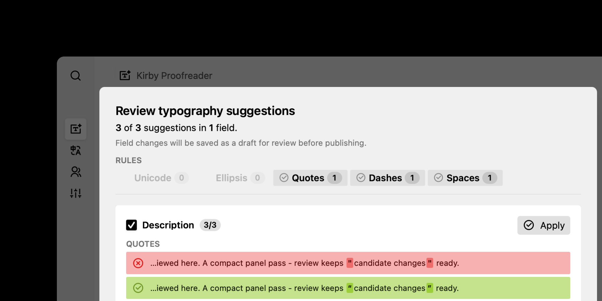

# Kirby Proofreader

Kirby Proofreader adds a Panel button on Kirby CMS for reviewing typographic corrections in content views before applying them. Field changes are saved to Kirby's changes version, title fixes use Kirby's native title action and save immediately.



## Requirements

- Kirby 5.2+
- PHP 8.2+

## Installation

```bash
composer require grommasdietz/kirby-proofreader
```

> [!TIP]
> For a manual install, download the **Source code (zip)** archive of an immutable GitHub release tag and copy it to `site/plugins/kirby-proofreader`.

## Quickstart

Add the button to a page, site, file, user or custom area blueprint:

```yaml
buttons:
  proofreader: true
  languages: true
  status: true
  settings: true
```

See [usage](docs/usage/index.md) for rule configuration, language-aware corrections, protected spans and CLI review/fix commands.

### Documentation

Full reference for [usage](docs/usage/index.md), [contributions](docs/contributions/index.md) and [maintenance](docs/maintenance/index.md) lives in [documentation](docs/index.md).

---

## Changelog

See [CHANGELOG.md](CHANGELOG.md) for version history and changes.

---

## Security

See [SECURITY.md](SECURITY.md) for security policies and reporting vulnerabilities.

---

## Contributing

See [CONTRIBUTING.md](CONTRIBUTING.md) for guidance and expectations.

---

## License

[MIT](LICENSE.md) © 2026 Grommas Dietz
